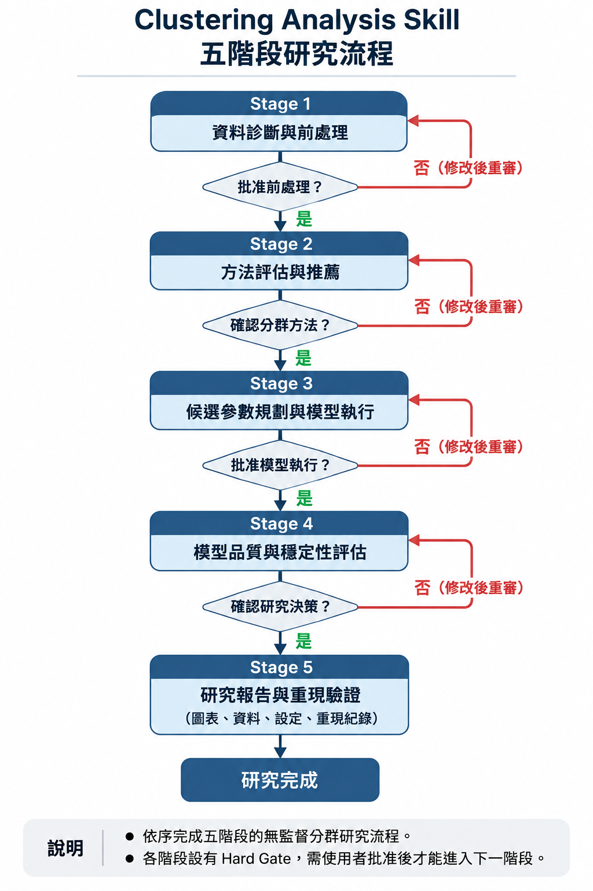

# Clustering Analysis Skill

**一套以 Python 為核心、具備階段式決策機制的無監督分群分析 Skill。**

**版本：** `v1.0.0rc6.post1`  
**開發語言：** Python  
**研究領域：** Unsupervised Learning、Cluster Analysis、Applied Statistics

---

## 下載與安裝

**目前版本：v1.0.0rc6.post1**

[⬇️ 下載 Clustering Analysis Skill 安裝套件（ZIP）](https://github.com/r26141049/clustering-analysis-skill/releases/download/v1.0.0rc6.post2/Clustering_rc6_post2_GateBridge_Plugin_Release.zip)

本專案提供可供下載的 Skill 套件，請依使用的 AI Agent 執行環境所支援的方式進行安裝或匯入。

目前已完成 ChatGPT Personal Skill 的功能驗收；其他 AI Agent 的完整相容性尚未驗證。

---

## 一、專案介紹

Clustering Analysis Skill 是一套協助使用者進行 **無監督分群研究(Unsupervised Clustering Analysis)** 的分析工具。

本專案不只是執行分群演算法，而是將統計研究過程整合成五個階段：

1. 資料診斷與前處理
2. 分群方法評估與推薦
3. 候選模型及參數規劃
4. 模型品質與穩定性評估
5. 研究解釋與可重現報告

Skill 會根據資料特性提供統計建議，並在重要決策點等待使用者確認，避免未經授權就改變前處理設定、執行模型或選定最終分群結果。

本專案特別重視以下原則：

- **資料導向**：依據 EDA 與實際診斷證據規劃分析。
- **方法適切性**：區分演算法能否執行，以及是否適合資料結構。
- **統計可解釋性**：提供選擇方法、群數及參數的理由。
- **研究可重現性**：保留模型設定、結果、圖表與執行紀錄。
- **使用者決策權**：重要分析階段必須通過 Hard Gate 授權。
- **不強迫選群**：證據不足時，允許保留多個候選或不選定最終模型。

---

## 二、支援的分群方法

目前正式支援四種分群方法。

| 方法 | 核心概念 | 主要研究用途 |
|---|---|---|
| K-means | 依據群中心與群內平方距離進行分割 | 探索中心型、較緊湊的群組結構 |
| Hierarchical Clustering | 根據觀測間距離逐步建立階層結構 | 研究群組合併、階層關係與不同切割 |
| DBSCAN | 以密度連通性形成群組 | 探索非凸形狀、局部密度與雜訊 |
| PAM / K-medoids | 以實際觀測作為群組代表點 | 適用於需要代表觀測或非歐氏相異度的研究 |

### 距離與資料型態

Skill 會依照方法及資料型態考慮適當的距離計算方式。

例如：

- 歐氏距離（Euclidean Distance）
- 曼哈頓距離（Manhattan Distance）
- Gower Distance：適用於混合型變數資料

不同方法具有不同的統計假設與適用限制，因此 Skill 不會僅依資料筆數或變數型態決定推薦方法。

---

## 三、完整研究流程

本專案使用五階段工作流程，並透過 **Hard Gate** 管理使用者授權。

**流程說明：**

- 藍色：主要研究階段。
- 黃色：需要使用者決策的 Hard Gate。
- 灰色：統計運算、診斷及成果交付。
- 綠色：流程開始與完成。

使用者可以修改研究設定、補充資料，或返回前一階段重新規劃。

修改已批准的設定時，相關下游授權及結果必須依照規則失效，避免混用不同版本的分析成果。

---

## 四、五階段功能介紹

### Stage 1：資料診斷與前處理

自動檢查資料的基本特性，例如：

- 觀測數與欄位型態
- 識別碼及不應加入模型的欄位
- 缺失值與重複資料
- 數值分布及極端觀測
- 特徵尺度與相關性
- 散佈圖及可能的群組幾何結構

Skill 會提出前處理建議，並說明是否需要標準化、變數轉換或其他處理。

**重要原則：EDA 可提供候選群組結構的線索，但不能單獨證明最佳群數。**

### Stage 2：方法評估與推薦

根據 Stage 1 的診斷證據，比較四種方法的適合性。

評估內容包括：

- 資料型態是否符合演算法要求
- 資料是否可能具有非凸或彎曲結構
- 極端觀測與雜訊的可能影響
- 群組密度及距離特性
- 各方法的主要限制及研究價值

Skill 會解釋推薦理由，但最終方法由使用者選擇。

### Stage 3：候選參數規劃與執行

依照選定方法提出候選設定。

例如：

| 方法 | 主要候選設定 |
|---|---|
| K-means | 群數 K、初始化方式、重啟次數 |
| Hierarchical | 群數 K、距離、Linkage |
| DBSCAN | eps、min_samples、距離 |
| PAM / K-medoids | 群數 K、距離、初始化與最佳化設定 |

候選範圍必須說明資料依據、探索目的及計算預算。

**提出候選計畫不代表取得模型執行授權。**

模型執行及結果確認分別受到 Hard Gate 管理。

### Stage 4：模型品質與穩定性評估

針對已批准的候選模型進行適當的統計比較。

依方法提供的診斷可能包含：

- Silhouette
- Calinski–Harabasz Index
- Davies–Bouldin Index
- WCSS / Inertia
- 群組大小與分布
- 初始化敏感性
- 子抽樣穩定性
- Adjusted Rand Index（ARI）
- 群組層級 Jaccard 相似度
- DBSCAN 雜訊比例及參數敏感性
- 階層式分群的合併高度與樹狀圖

並非所有指標都適用於每種分群方法。

Skill 會區分支持與反對的統計證據，不會直接以單一分數宣稱最佳模型。

### Stage 5：研究報告與可重現成果

整合已批准的研究設定及分析結果，建立完整研究報告。

報告包含：

- 資料與前處理說明
- 分群方法與參數
- 候選模型比較
- 群數與參數選擇理由
- 模型品質及穩定性證據
- 群組特徵與研究解釋
- 統計限制及未解決的不確定性
- 重現所需設定與執行紀錄

完成後，使用者可以下載研究成果進行保存、審閱或後續分析。

---

## 五、Hard Gate 決策機制

Hard Gate 是本專案的重要設計。

它讓使用者能控制分析流程，避免系統未經確認便執行後續研究。

### 授權原則

1. 每項批准都應對應明確的研究階段及待決事項。
2. 模糊回答與拒絕不能視為批准。
3. 過期或已使用的授權不得再次生效。
4. 不同 Session、階段或設定版本的授權不得混用。
5. 修改研究設定後，受影響的後續授權與結果應失效。
6. 模型執行、結果確認及最終研究決策必須區分。

### 使用方式

當 Skill 需要使用者決策時，通常會提供清楚的文字選項。

例如：

- `A`：接受目前方案
- `B`：修改目前方案
- `C`：補充資料或暫停

實際選項意義以當前階段顯示的內容為準。

---

## 六、統計圖表與成果交付

本專案會在各研究階段產生相應的統計圖表，讓使用者能依據實際證據做決策。

### 圖表

常見圖表包括：

- 數值特徵箱型圖
- 散佈圖與散佈矩陣
- 近鄰距離診斷圖
- WCSS 曲線
- Silhouette 與群組大小比較
- Dendrogram
- 穩定性及敏感性圖
- 最終分群散佈圖
- 群組特徵摘要圖

圖表以 PNG 檔案提供，並可在研究交付包中保存 SVG 向量版本。

### 最終研究成果

研究交付內容依分析方法而有所不同，常見檔案包括：

| 檔案 | 用途 |
|---|---|
| `analysis.md` | Markdown 研究報告 |
| `analysis_offline.html` | 可離線閱讀、圖片內嵌的 HTML |
| `cluster_assignments.csv` | 逐筆觀測的分群結果 |
| `candidate_comparison.csv` | 候選模型及品質比較 |
| `numeric_profiles_raw_units.csv` | 原始尺度的群組特徵摘要 |
| `config.json` | 研究設定 |
| `decision_log.json` | 重要決策紀錄 |
| PNG / SVG | 統計圖表 |
| Reproduction records | 研究重現及檢查紀錄 |

實際檔名以分析交付包為準。

---

## 七、如何使用

### 安裝

本專案以 ChatGPT Skill 套件形式提供。

請從 GitHub Releases 取得對應版本的安裝套件，依使用環境支援的 Skill 匯入方式完成安裝。

目前主要驗收環境為 ChatGPT Personal Skill。

### 啟動研究

完成安裝後，開啟新對話並上傳欲分析的資料集。

接著輸入：

> 請使用已安裝的 Clustering Analysis Skill，對這份資料進行完整的無監督分群研究。
>
> 請依照內建五階段流程完成資料診斷、方法推薦、候選規劃、模型品質與穩定性評估，以及可重現研究報告。
>
> 每個需要使用者決策的階段請停下來，等待我的選擇。

Skill 會根據資料內容提出分析建議。

使用者不需要預先指定最佳群數，也不需要自行撰寫完整的統計分析程式。

---

## 八、研究案例

本專案使用不同資料型態與分群結構進行功能及研究驗證。

| 研究案例 | 方法 | 驗證重點 |
|---|---|---|
| Iris | K-means | 候選群數、EDA、分離品質及穩定性 |
| Restaurant Tips | PAM / Gower | 混合型資料、Gower 距離與 Medoid |
| Two Moons | DBSCAN | 非凸結構、密度參數與雜訊 |
| Breast Cancer Wisconsin | Hierarchical / Ward | 高維數值特徵、階層合併及穩定性 |
| Elliptical | K-means | 不同方向的點雲、候選群數與交付流程 |

這些案例用於檢查 Skill 在不同資料條件下的分析能力。

研究結果不應被解讀為所有資料集都適用相同的分群方法或參數。

---

## 九、統計研究原則與限制

### 1. 無監督分群不等於真實分類

分群演算法會依照特徵、距離及模型設定建立群組。

即使結果具有良好的 Silhouette 或穩定性，也不能直接證明資料存在唯一的自然分群。

### 2. 不同選群指標可能互相衝突

例如：

- Silhouette 偏好較少群
- WCSS 隨 K 增加持續下降
- CH 指標偏好較多群
- 某些細分群在重新抽樣時不穩定

遇到證據衝突時，Skill 應保留解釋及限制，而不是強迫所有指標支持同一結果。

### 3. 穩定性不等於統計顯著性

重新抽樣的一致性只能支持特定研究條件下的分群穩定程度，不能直接證明母體存在相同的自然群組。

### 4. 資料前處理會影響分群結果

標準化、變數轉換、特徵選擇及權重可能改變距離及群組結構。

因此，研究報告必須保存實際使用的前處理設定。

### 5. 允許不選定最終模型

若目前證據不足或候選結果存在重要衝突，使用者可以要求擴充分析、保留替代模型，或不選定最終群數。

---

## 十、版本資訊

### v1.0.0rc6.post1

目前正式驗收的版本，主要功能包括：

- 四種分群方法
- 五階段研究工作流程
- EDA 證據傳遞及方法適合性評估
- 具依據的候選參數規劃
- 模型品質與穩定性比較
- Hard Gate 階段授權
- PNG 附件與離線 HTML 交付
- 可重現研究報告
- 方法選擇 payload 相容性修復

正式功能不包含 Gaussian Mixture Model（GMM）。

### 介面限制

不同 ChatGPT 執行環境可能具有不同的圖片呈現方式。

本專案以可開啟的 PNG 附件及離線 HTML 提供統計視覺化成果，並以明確的文字選項進行使用者決策。

---

## 十一、未來發展

未來可考慮：

- 改善圖表在對話介面中的直接展示
- 支援原生可點選決策元件
- 擴充研究報告排版與匯出格式
- 強化不同執行環境的自動驗收
- 增加更多方法與資料情境的相容性測試

所有新增方法及統計診斷均應經過獨立驗證後，再納入正式功能。

---

## 十二、授權與引用

本專案的開源授權條款以 Repository 中的 `LICENSE` 為準；公開前應確認相關第三方程式、文件及範例資料的使用權限。

如需引用本專案，可使用以下格式：

**Clustering Analysis Skill (v1.0.0rc6.post1). Python-based stage-gated unsupervised clustering research skill.**

---

## 十三、作者

**專案名稱：** Clustering Analysis Skill  
**主題：** Unsupervised Learning / Clustering Analysis  
**開發語言：** Python  
**版本：** v1.0.0rc6.post1
